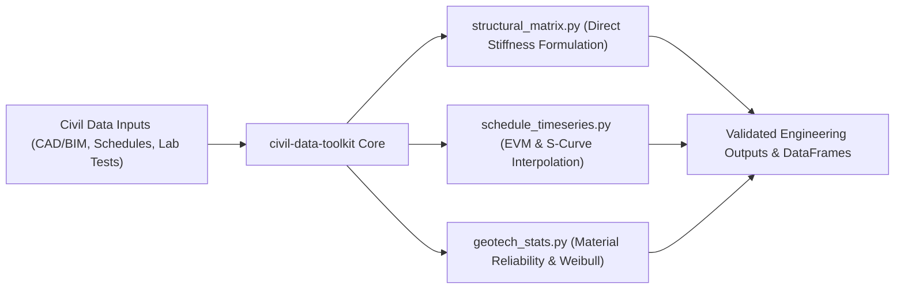

# Civil Data Toolkit
### High-Performance Computational & Analytics Utilities for Civil & Structural Engineering

[](https://www.python.org/)
[](https://opensource.org/licenses/MIT)
[](https://github.com/psf/black)

A modular Python library bridging classical civil engineering mathematics (Matrix Structural Analysis, Geotechnical Statistics, and Earned Value Management) with modern vectorized scientific computing using NumPy, SciPy, and Pandas.



## Key Features
- **Vectorized Matrix Stiffness Solver:** Global stiffness matrix assembly and boundary condition elimination for 2D trusses and frames with $O(N)$ sparse optimization.
- **Earned Value Management (EVM) Analytics:** Automated computation of SPI, CPI, EAC, and cubic spline interpolation of S-curves from project schedules.
- **Geotechnical & Material Reliability:** Continuous distribution modeling (Log-Normal, Weibull) for soil mechanics and concrete compressive strength datasets.

## Quickstart

```bash
git clone https://github.com/master-dev0000/civil-data-toolkit.git
cd civil-data-toolkit
pip install -r requirements.txt
pytest tests/
```

### Example: Matrix Stiffness Calculation
```python
from src.structural_matrix import Truss2D

truss = Truss2D()
truss.add_node(0, 0.0, 0.0, fix_x=True, fix_y=True)
truss.add_node(1, 4.0, 0.0, fix_x=False, fix_y=True)
truss.add_node(2, 2.0, 3.0, fix_x=False, fix_y=False)

# E = 200 GPa, Area = 0.0025 m2
truss.add_member(0, 1, E=200e9, A=0.0025)
truss.add_member(1, 2, E=200e9, A=0.0025)
truss.add_member(0, 2, E=200e9, A=0.0025)

truss.add_load(node_id=2, fx=0.0, fy=-50000.0)
results = truss.solve()
print(results['displacements'])
```

## License
MIT License. Developed by André Belarmino Alves.
